# Myelin user guide

This guide is for the person who runs a Myelin server and looks after it day to day through its
management interface. It starts with a short section for the people who use the server, which
you can send them as it is.

The management interface is at `/admin/` on your server's address, for example
`https://matrix.example.org/admin/`. Every screenshot here was taken from a real `hs serve`
with made-up people and rooms on a server named `example.org`; how to take them again is at the
end.

Contents:

- [For people who use the server](#for-people-who-use-the-server)
- [1. First sign-in](#1-first-sign-in)
- [2. The Overview](#2-the-overview)
- [3. Users](#3-users)
- [4. Rooms](#4-rooms)
- [5. Bridges](#5-bridges)
- [6. Federation](#6-federation)
- [7. Configuration](#7-configuration)
- [8. The other pages](#8-the-other-pages)
- [9. Where to go next](#9-where-to-go-next)

## For people who use the server

Myelin is a Matrix server. You use it through a Matrix app such as Element (web, desktop, iOS
and Android); the management interface is only for administrators.

**Connect.** In Element, choose Sign in, then Edit next to the homeserver, and type the
server's address: its name (`example.org`), or the address your administrator gave you. Any
Matrix app works the same way.

**Get an account.** Sign-up is closed on a new server, so an administrator either makes your
account and gives you its username and password, or sends you an invite link. An invite link
opens a page on the server that asks you to choose a username and a password:

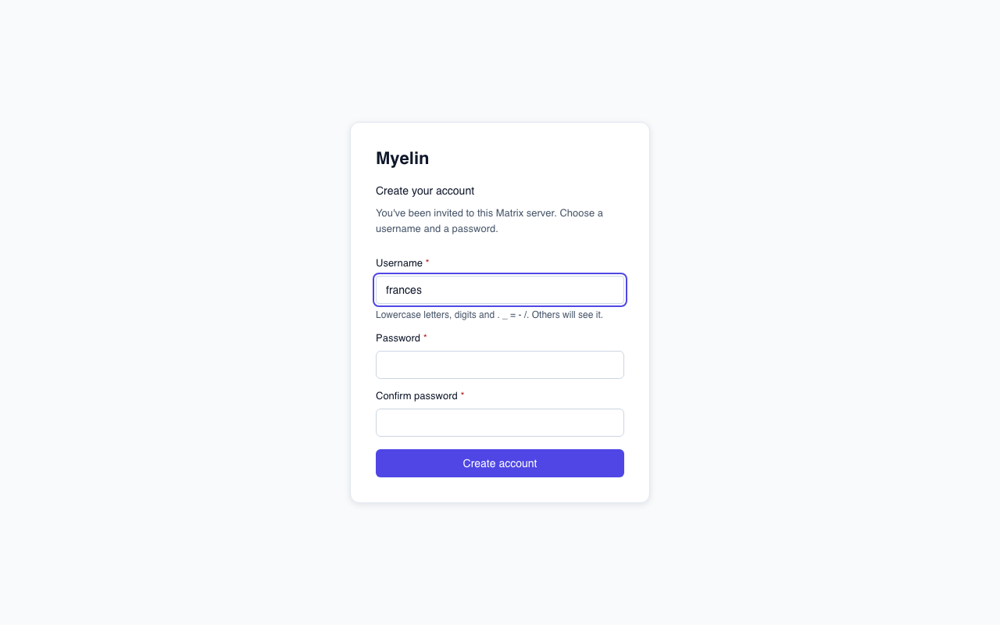

When the account is made, the page shows your Matrix ID (`@you:example.org`). Sign in with it
from Element. If your administrator has opened sign-up to everyone, you can register from
Element directly.

**Get a bridge.** A bridge connects your Matrix account to another network, such as WhatsApp.
If your administrator offers one, start a chat with its bot: for WhatsApp that is
`@whatsappbot:example.org` (your administrator can tell you the exact name). The server sets up
your own bridge, then its bot invites you to a chat with the steps to sign in to that network;
for WhatsApp you link it the way you link WhatsApp Web, by scanning a code from your phone.
Where the server cannot start bridges itself, the bot says an administrator runs it for you,
and it works once they have started it.

## 1. First sign-in

### Make the first administrator

A new server has no accounts, so nobody can sign in yet. Each time it starts without an
administrator, it writes a one-time setup link to its log:

```
WARN this server has no administrator yet: open the setup link to create one. It works once,
     for whoever opens it first setup_link=http://localhost:8008/admin/setup#token=...
```

Find it with `docker logs myelin`, `kubectl -n <namespace> logs statefulset/<release>-hs | grep
setup_link`, or in the output of `hs serve`. Open the link. If it names `localhost` and you
reach the server at another address, keep everything from `/admin/setup#token=` on and replace
the part before it; the token is what matters. Setting `server.public_baseurl` (in Helm,
`publicBaseUrl`) makes the server write the right address in the first place.

The page asks for a username and a password:

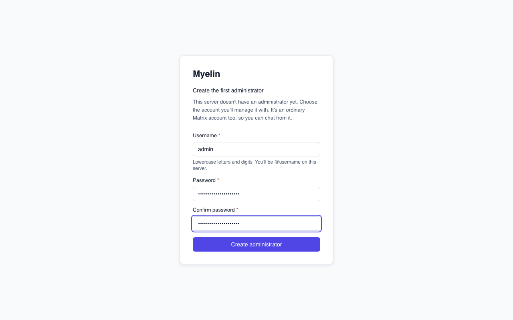

Choose them and press **Create administrator**. You are signed in and land on the Overview.
The account is an ordinary Matrix account too, so you can chat from it in Element. The link
works once: after that, the server stops writing it, and opening it again says the server is
already set up.

### Sign in later

Open `/admin/`. Sign in with any administrator's Matrix username and password; there is no
separate admin login. The **Access token** tab takes an access token instead, for example one
copied from Element's settings.

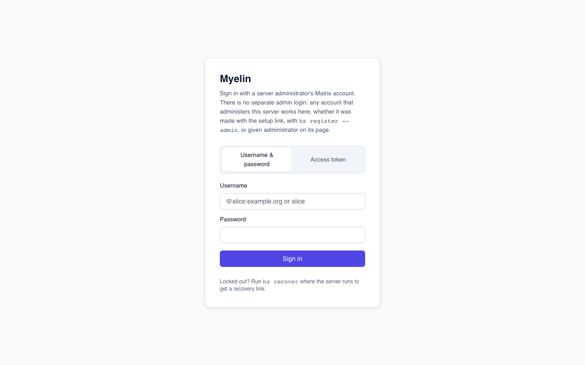

To give someone else administrator rights, open their page under Users, press **Edit** and turn
on **Server administrator**, or make them an administrator when you add the account.

### Locked out

If nobody can sign in as an administrator (the password is forgotten, say), run `hs recover`
where the server runs. It signs its request with the server's signing key, so only someone who
can reach that key gets a link:

| Where the server runs       | Run                                                        |
| --------------------------- | ---------------------------------------------------------- |
| Kubernetes (the Helm chart) | `kubectl -n <namespace> exec <release>-hs-0 -- hs recover` |
| Docker                      | `docker exec <container> hs recover`                       |
| A host                      | `hs recover --data-dir ./data`                             |

It prints a link to `/admin/recover#token=...`. Open it, choose a new password for the
administrator account it shows, and press **Reset password and sign in**. Every other session of
that account is signed out. The link works once and expires after fifteen minutes; running
`hs recover` again replaces it.

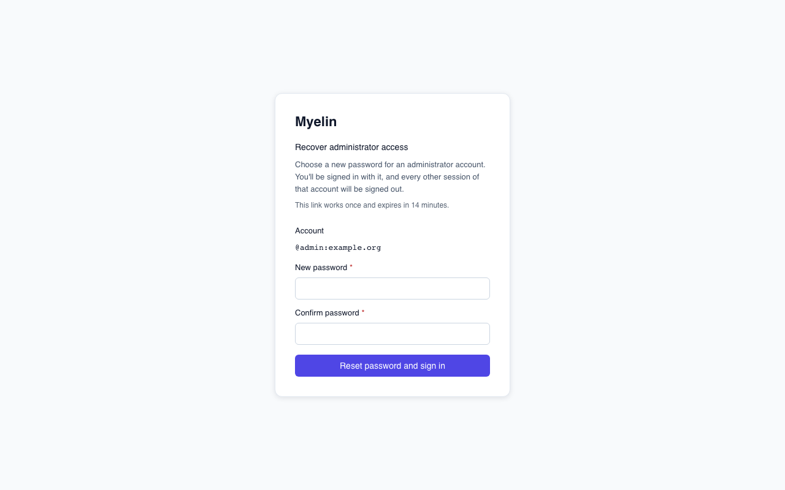

If the server has no active administrator at all, `hs recover` prints a setup link instead.
`docs/recovery.md` explains why the signing key is the credential and what the link can and
cannot do.

## 2. The Overview

The Overview is the first page after sign-in. The line under the heading gives the server's
name, version, how it runs (one process, or a cluster) and how long it has been up.

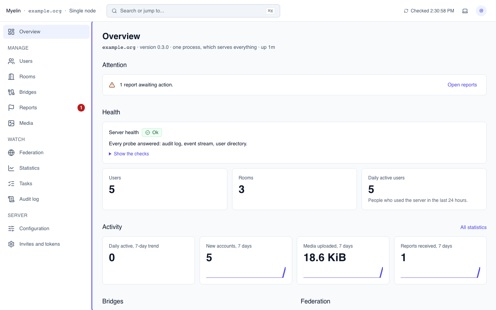

- **Get started** appears only on a new server with nobody but you on it. It links to the usual
  first steps: add people, let people sign up, offer a bridge, move from Synapse.
- **Attention** lists what needs you: reports waiting for a decision, a bridge that is degraded
  or down, servers that federation cannot reach. Each line links to the page that deals with it.
- **Health** says whether the server's own checks pass; **Show the checks** lists them.
- The counts (users, rooms, daily active users) are recounted at most once a minute, so a user
  you have just added can take a minute to show here. **Activity** has small charts; **All
  statistics** opens the Statistics page.

The bar at the top shows the server's name and mode. **Search or jump to...** (or ⌘K / Ctrl+K)
jumps to any page, or to a bridge, by name. The sidebar groups the pages into **Manage** (people,
rooms, bridges, reports, media), **Watch** (federation, statistics, tasks, the audit log) and
**Server** (configuration, invites and tokens). Two pages only appear in the sidebar when they
apply: **Cluster** when the server runs as more than one replica, and **Migration** on a new
server or while a migration is under way. Both can always be opened by address, `/admin/cluster`
and `/admin/migration`.

## 3. Users

**Users** lists every account on the server with its status, when it was last seen and how many
devices it has. Search by user ID, display name or email; **Find by email, phone or sign-in
provider** looks up one account by its exact address or provider identity; **Suspended only**
narrows the list.

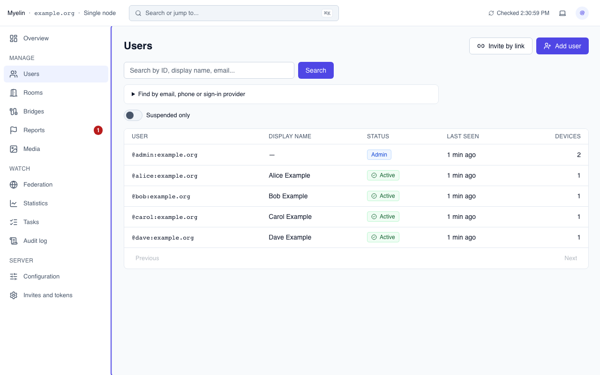

### Add a user

1. Press **Add user**.
2. Type a username (it becomes `@username:example.org`), and optionally a display name.
3. Type a password, or press **Generate** to make one; a generated password is shown so you can
   hand it over.
4. Leave **Server administrator** off unless they will run the server with you.
5. Press **Create account**.

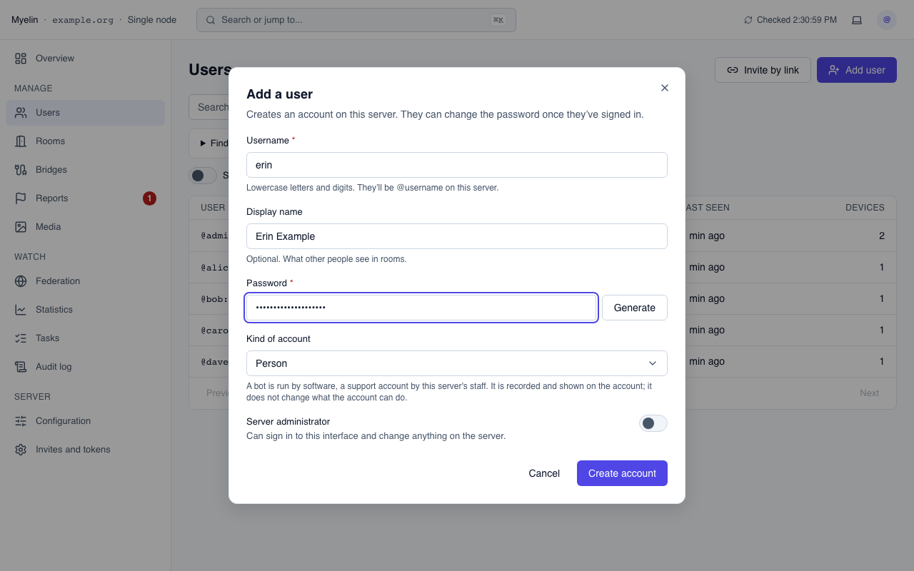

The next dialog shows the user ID and the password once. Give both to the person; they can
change the password after they sign in.

### A user's page

Click a user to open their page. The buttons at the top are **Edit** (display name, avatar, kind
of account, administrator), **Lock**, **Send notice**, **Reset password** and **Sign out everywhere**. Below
are their sessions (each can be renamed or signed out), how they appear to others, email
addresses and phone numbers, and the identities they sign in with elsewhere. **Moderation**, on
the right, has suspension (they can read but not send), shadow-ban, a per-user message rate
limit, and buttons to redact their messages or delete their media.

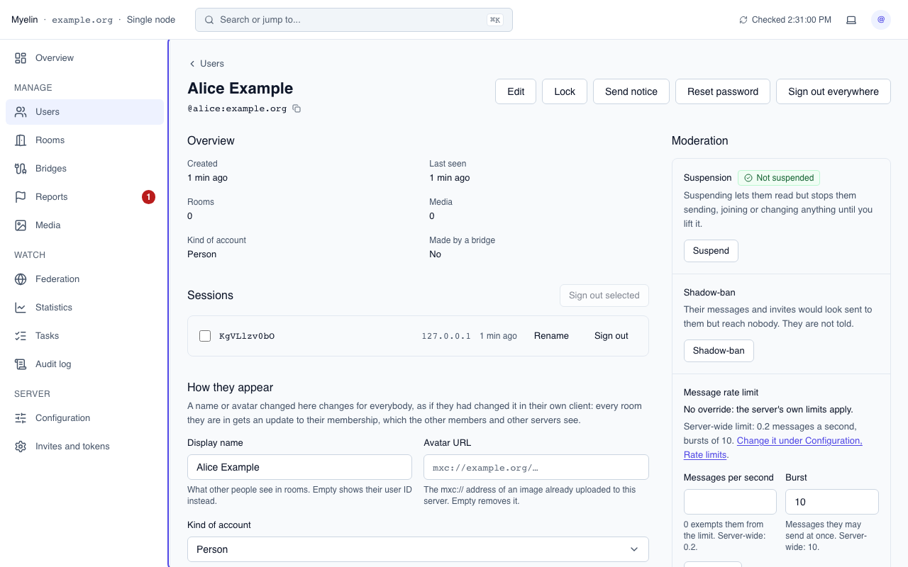

### Reset a password

On the user's page, press **Reset password**, type a new password or press **Generate**, and
press **Reset password**. **Sign out everywhere** is on by default, so every device they use
has to sign in again with the new password. The next dialog shows the password once to pass on.

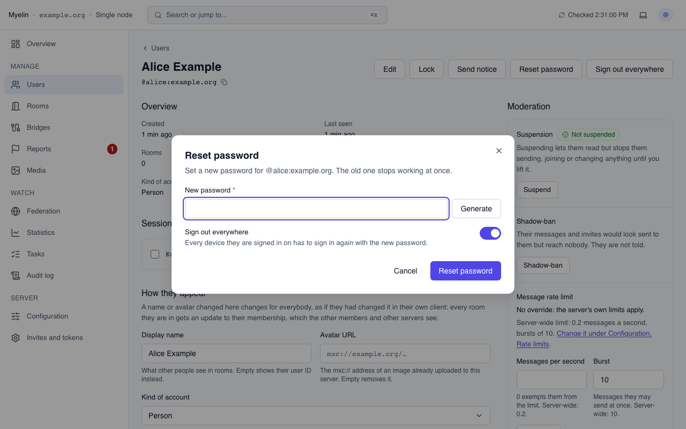

### Deactivate a user

At the bottom of the user's page, under **Danger**, press **Deactivate**. They are signed out
everywhere and cannot sign in again. Their messages stay where they are unless you redact them.
Tick **Also erase their data** to remove their password, sessions, devices and keys, email,
phone, display name and avatar and take them out of every room; an erased account cannot be
reactivated. Without it, **Reactivate** on the same page lets them back in.

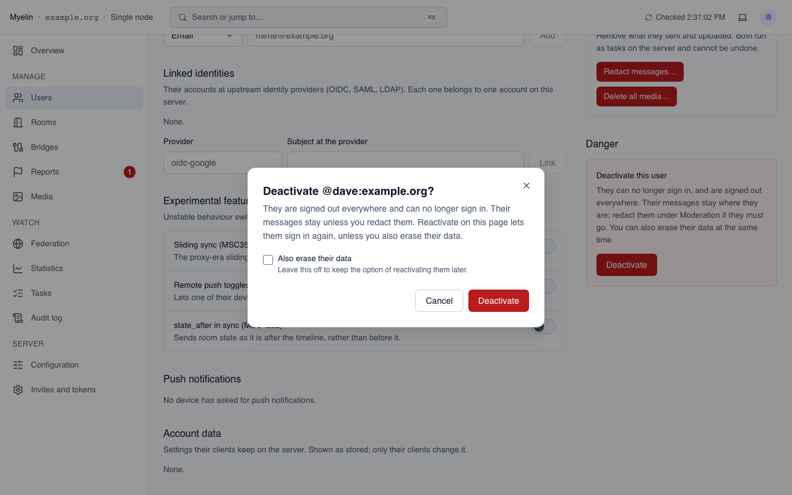

### Invite links

Sign-up from apps is off on a new server. An invite link lets one person (or as many as you
allow) make their own account while it stays off for everyone else. The Matrix specification
calls the token in the link a registration token.

1. Open **Invites and tokens** in the sidebar (or **Invite by link** on the Users page). The
   **Invite links** tab is first.
2. Press **Create invite link**.
3. Keep **Generate one**, or choose **Choose my own** and type a word people can read out.
4. Set how many accounts it may create and when it expires (7 days unless you change it).
5. Press **Create invite link**, then copy the link from the next dialog and send it.

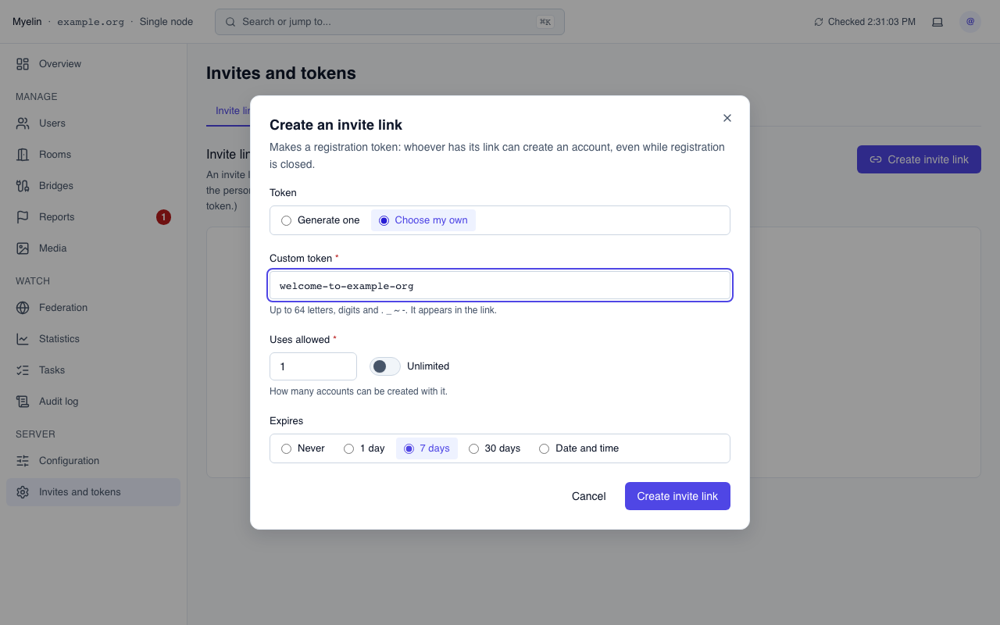

The list shows each link's status, how many times it has been used, and when it expires.
**Copy invite link** copies it again; **Edit** changes its limits; **Delete** stops it working.
What the invited person sees is shown in [the first section](#for-people-who-use-the-server).

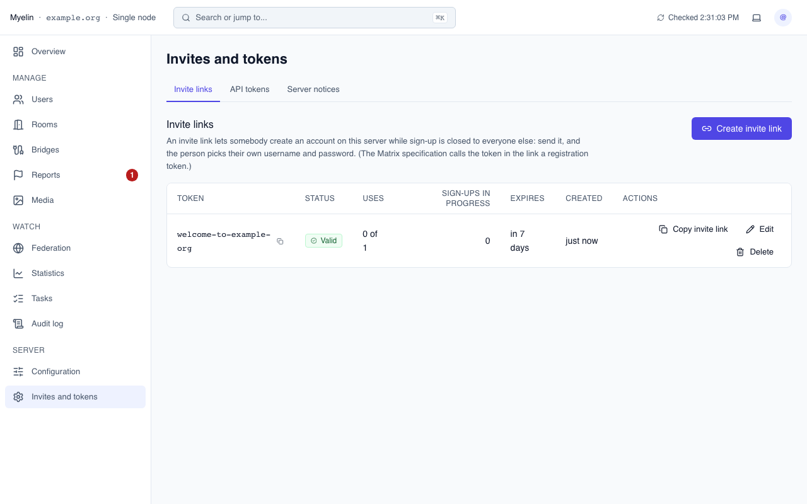

### Open sign-up to everyone

Whether anyone can make an account from an app is a setting: **Configuration**, **Sign-in and
registration**, **Enable registration**. It is off by default. Turned on, anyone who can reach
the server can sign up, so most servers keep it off and use invite links. The change applies to
the running server as soon as you save it (see [Configuration](#7-configuration)).

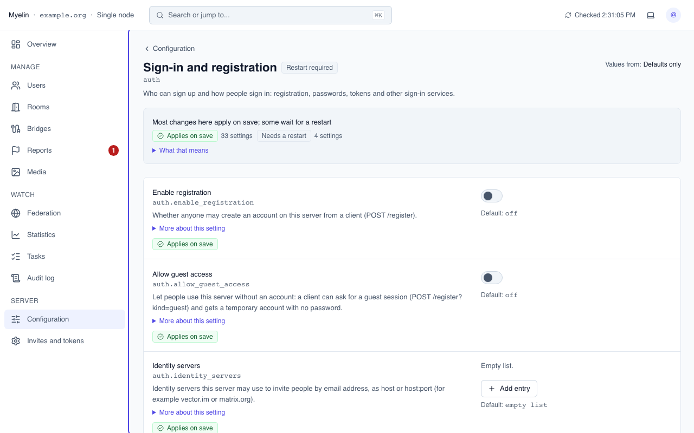

## 4. Rooms

**Rooms** lists the rooms this server knows, with their flags (public, blocked, encrypted), the
number of members (this server's and all) and the room version. Search by room ID, alias or
name. **Find an event by its ID** opens the room an event belongs to.

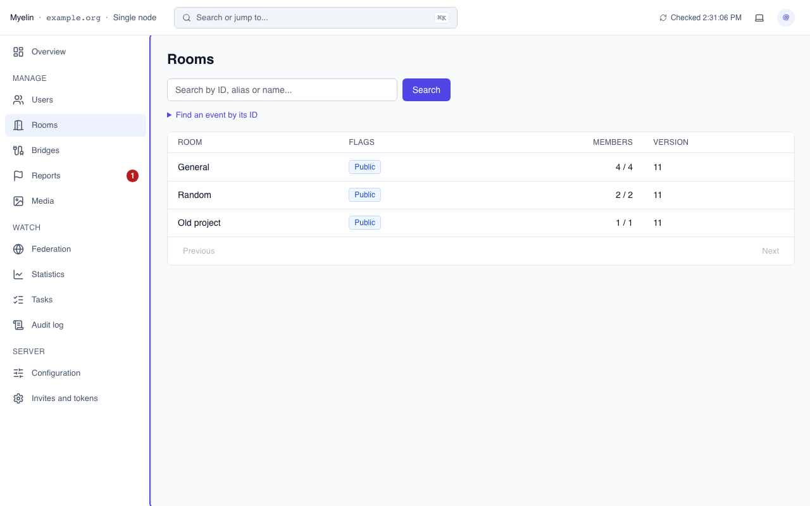

Click a room to open its page. **Overview** says who made it, who can join, who can read its
history, how many members and state events it has, and lists the members. The other tabs are
**State** (the room's settings as events), **Timeline** (its messages), **Aliases** (add and
remove addresses like `#general:example.org`), **Media** and **Extremities**; a space also has a
**Space** tab with its rooms.

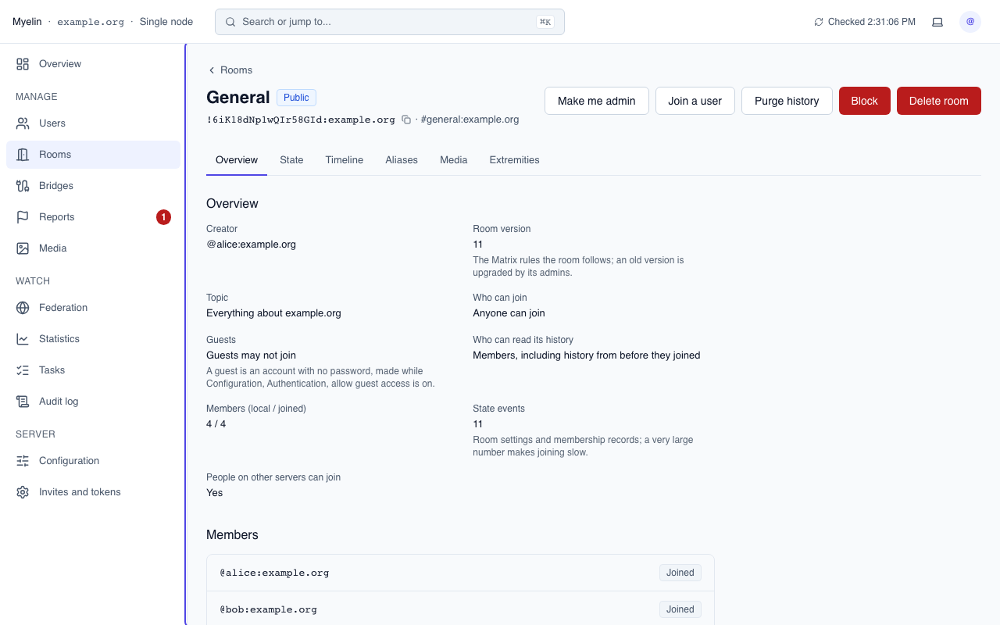

Reading a room's messages in the **Timeline** tab is recorded in the audit log under your name,
and the page says so. **Jump to date** goes to a point in its history, and clicking a message
shows it in context.

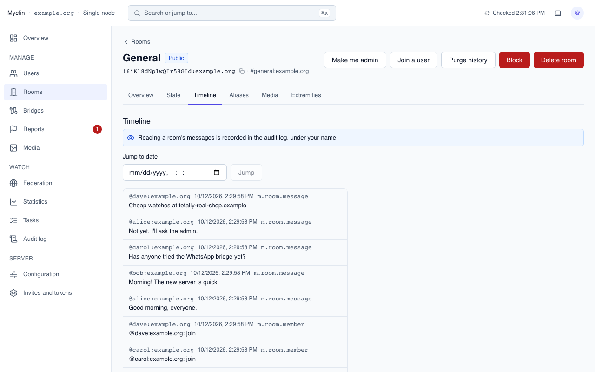

What can be done to a room, from the buttons at the top:

- **Make me admin** joins you to the room with full power, granted by a member of this server
  who has it.
- **Join a user** puts a local user into the room.
- **Purge history** deletes messages older than a time you choose. It runs as a task.
- **Block** stops anyone on this server joining it; you are asked for a reason, which the room
  keeps.
- **Delete room** makes every local member leave, removes its local aliases and takes it out of
  the directory. You can purge it from the server, block it, or move its members to a new room
  first. Type the room's name to confirm. Deleting runs as a task, and you are taken back to the
  room list.

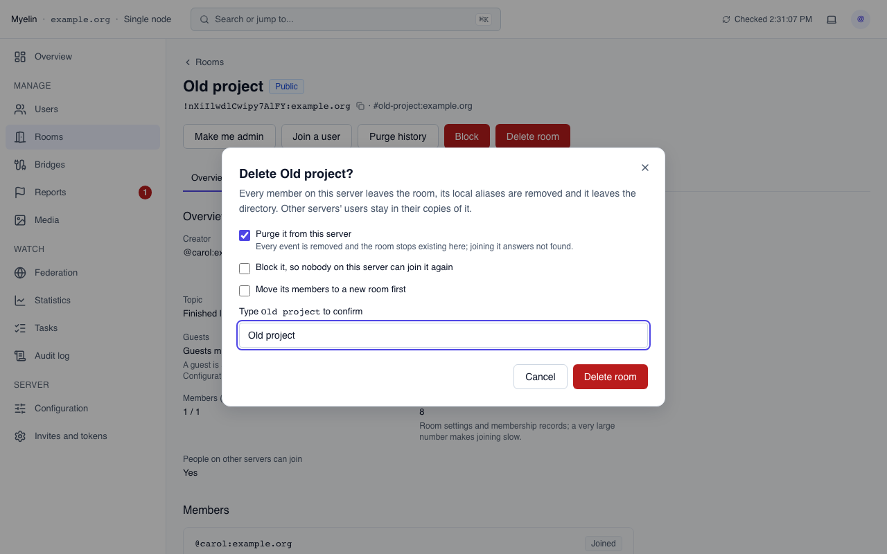

## 5. Bridges

A bridge connects this server to another network: WhatsApp, Signal, Telegram, Discord, iMessage
and others. The usual way is to **offer** a network: each person who wants it then gets their
own bridge by messaging its bot, with its own registration and process, so one person's trouble
touches nobody else.

**Bridges** opens on **Offered bridges**. If the server is not running in Kubernetes with the
Helm chart's bridges enabled, a note says so: the server cannot start bridges itself, and each
one runs elsewhere, from files the interface gives you.

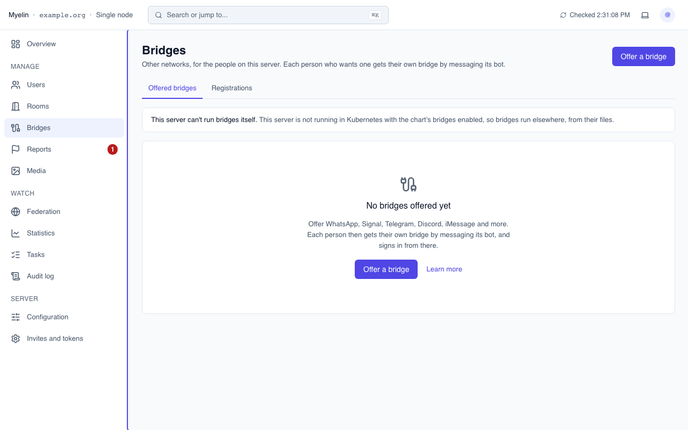

### Offer a bridge

1. Press **Offer a bridge**.
2. **Kind**: choose the network. Each card says what it needs (for WhatsApp, a phone to link
   it to) and whether each person gets their own.
3. **Access**: who may have one: everyone on this server, or the people you name.
4. **Runtime**: **Runs in this cluster** when the server can start bridges as pods, or **Runs
   elsewhere**. The option that is not available says why.
5. **Options**: encryption, double puppeting, backfill and the like, with sensible defaults.
6. **Review**, then press **Offer** (for example **Offer WhatsApp**).

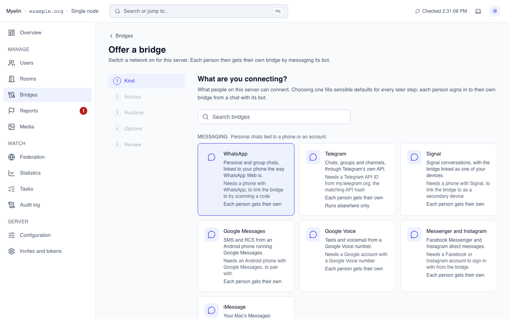

The offering's page says how people get one ("Anyone here can message
@whatsappbot:example.org to get their own WhatsApp bridge"), shows its settings and image, and
lists **People's bridges**. **Add for a user** makes one for somebody without waiting for them
to message the bot. Each row shows the bridge's state, whether it answers pings and whether the
person has signed in to the network. For a bridge that runs elsewhere, **Files** gives its
`config.yaml`, its registration and a Kubernetes manifest; until somebody runs it, the row
says it is waiting for that and its ping shows as degraded. **Remove** deletes that person's
bridge and nothing else. **Edit settings** and **Stop offering** are at the top.

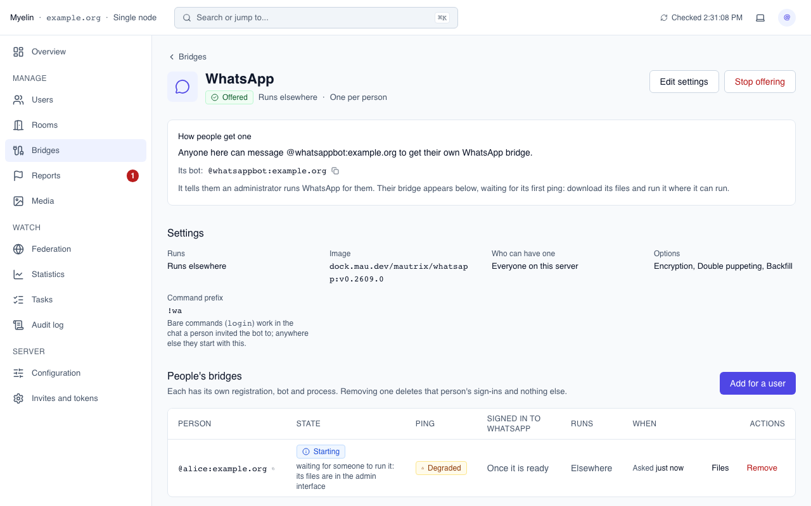

The list of offered bridges shows each network, where it runs, the bot people message and how
many bridges it has.

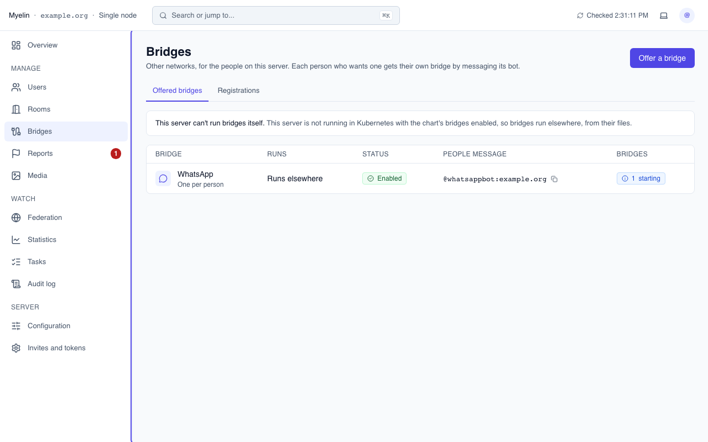

### Registrations

The **Registrations** tab lists every bridge registered with the server: each person's bridge,
the server's own bridge manager, and any bridge you run yourself. It shows each one's health,
whether events are waiting to be sent to it, and its bot. Pause and resume are on each row.
**Register a bridge you run yourself** walks through a bridge you operate outside the offerings
(heisenbridge, for example): it renders the bridge's configuration and registration, says how to
start it, and turns green when it connects.

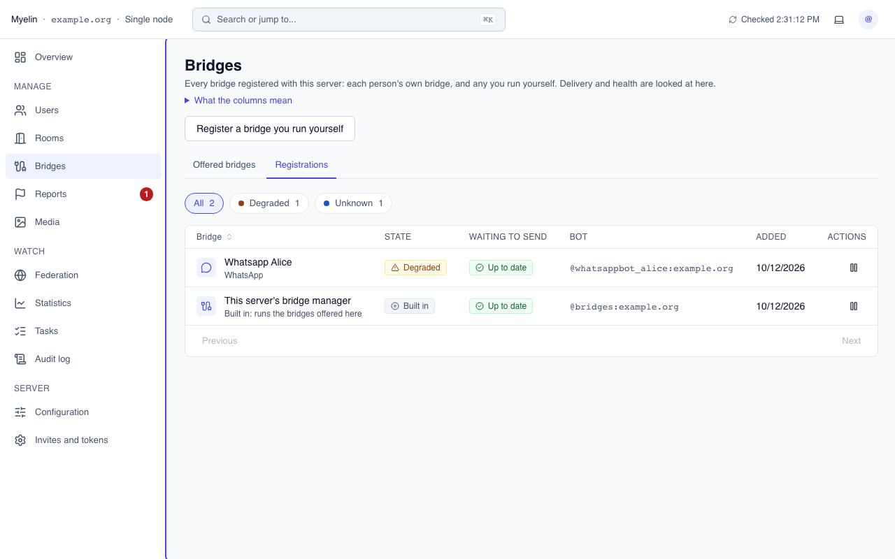

What a person sees is in [the first section](#for-people-who-use-the-server).
`docs/bridges/` has notes on individual bridges.

## 6. Federation

**Federation** lists the other Matrix servers this one sends to: every server with a user in a
room your users are in. Each row says whether sending to it works now, when it last succeeded,
how much is waiting to be sent, and how many rooms the two servers share. Failing servers come
first. The filters are **Every server**, **Failing**, **Not failing** and **No shared room**;
**What the statuses mean** explains each status.

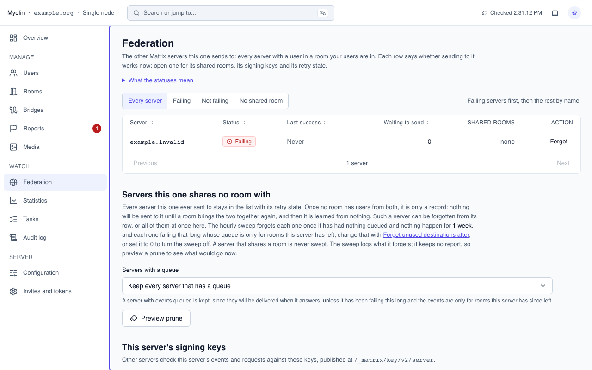

The screenshot's server, `example.invalid`, does not exist, so every attempt fails. Below the
list, **Servers this one shares no room with** explains how servers nobody shares a room with
any more are forgotten (an hourly sweep, after a week by default), and **Preview prune** shows
which ones would go now before you remove them. The page ends with this server's own signing
keys.

Click a server to open its page. It says what the status means, when it last succeeded and last
tried, when it will try next, and what is waiting for it. **Reset backoff** forgets the failures
and tries at once: use it when you know the server is back. **Forget this server** drops its
queue, retry state and cached keys; it is refused while a room is shared unless you insist.

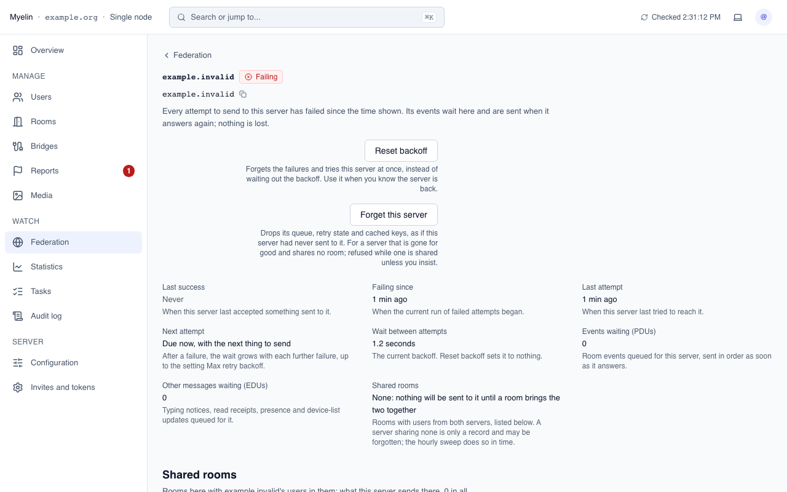

## 7. Configuration

Myelin keeps its settings in its own database, not in a file on the host, and you change them
here. Every setting has a default the server works with untouched. A few are **bootstrap**
settings that the process needs before it can read the database (where the database is, the
listeners, the server name, the signing key's path); those come from the command line,
environment variables or Helm values, and are shown here read-only.

**Configuration** shows one card per section. Each card says what the section is for, whether
its changes apply at once (**Reloadable**), need a restart (**Restart required**) or are set at
install (**Bootstrap only**), and how many of its settings differ from the default. **Search all
settings** finds a setting by name. **How a change takes effect** explains the
badges.

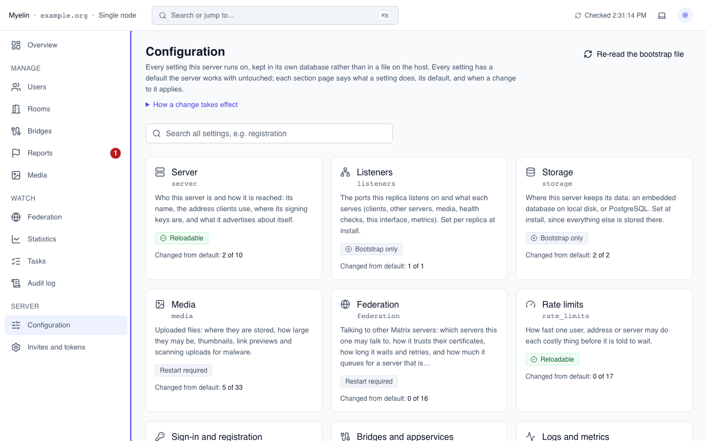

Open a section to change it. Each setting says what it does, its default, and when a change
applies: **Applies on save** or **Needs a restart**. **More about this setting** has the full
explanation. A section's badge is the slowest of its settings, so a section marked **Restart required** can
still have most of its settings apply on save; the box at the top of the page counts each
kind.

To change a setting:

1. Change the value. The setting is marked **Edited**, and a bar at the bottom counts the
   unsaved changes. **Undo** reverts one; **Discard** reverts them all.

   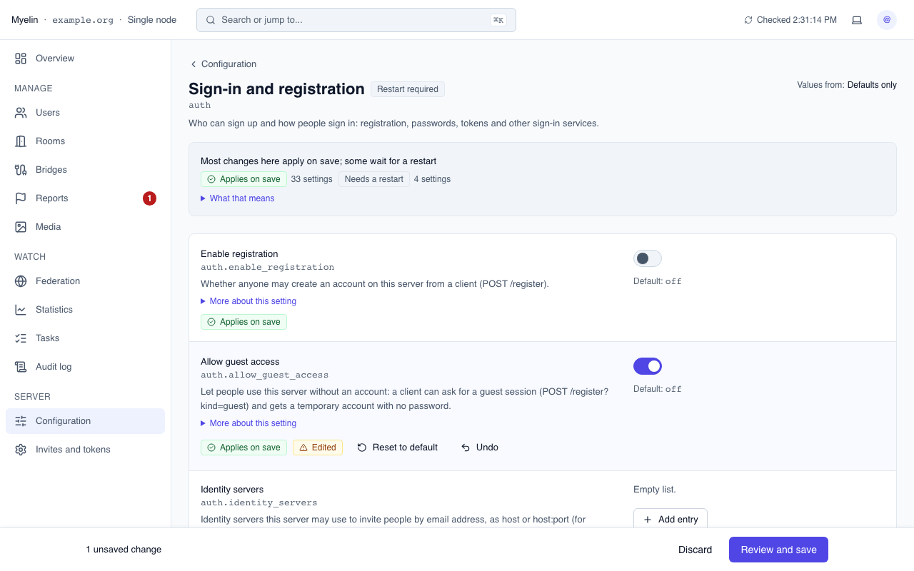

2. Press **Review and save**. The dialog lists each change from old to new value and says when it
   applies. **Check without saving** asks the server to validate the change without storing it.

   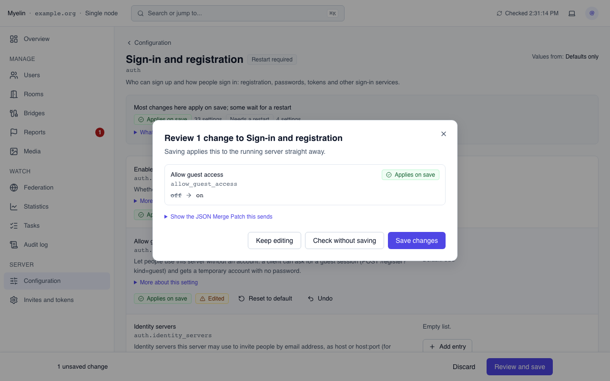

3. Press **Save changes**. A message confirms what was applied to the running server; a setting
   that needs a restart is stored and takes effect at the next start, and the message says so.

   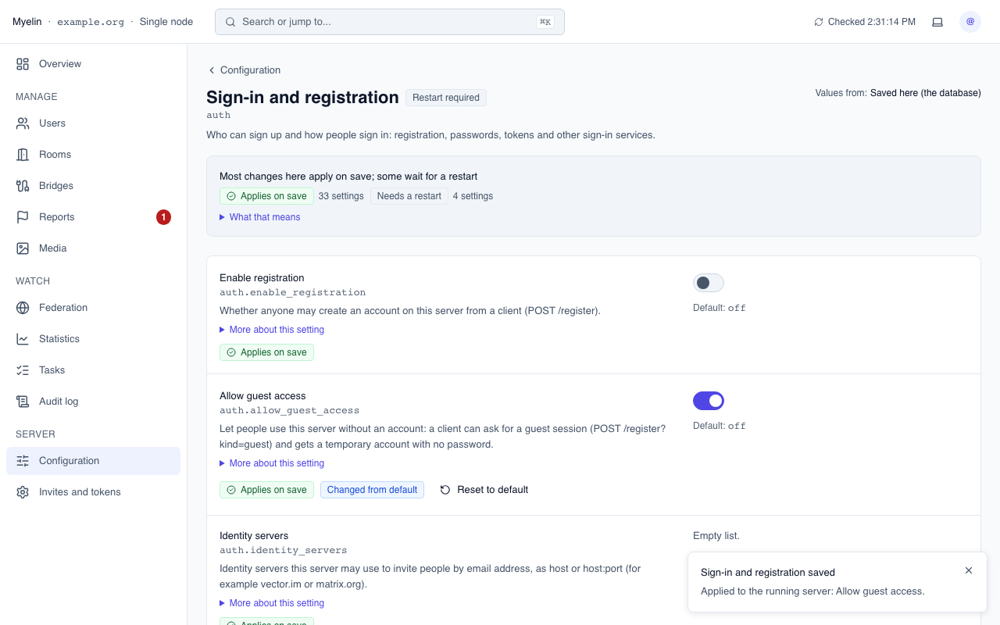

Every change is in the section's history at the bottom of its page, and in the audit log. A
change can be reverted from the history. `docs/config.md` lists every setting with its default
and when it applies.

## 8. The other pages

### Media

**Media** lists files uploaded here and this server's copies of files from other servers, with a
preview, the uploader, type, size and dates. Search by name, uploader, type or ID, and filter by
local or remote and by status. Click a file to see it and to **Quarantine** it (withheld from
everyone but administrators, without deleting it), protect it, or delete it. **Delete old
media** and **Purge remote cache** clear space in bulk; both run as tasks.

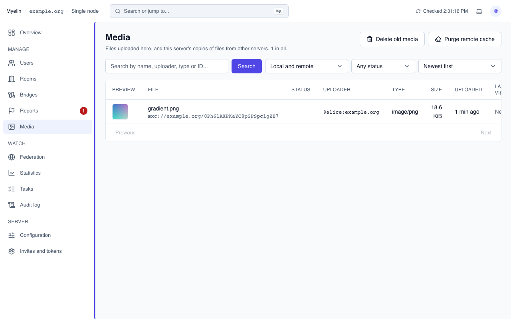

### Reports

**Reports** lists what people on this server have reported: a message, a room or a person, with
the reason, who reported it and when. Open reports are shown first; the filters change status,
kind and order.

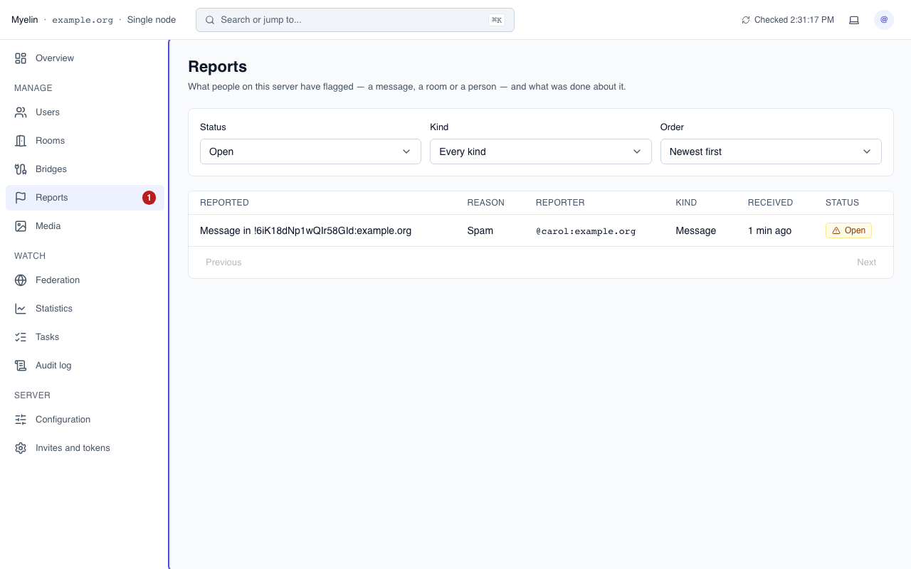

A report's page shows what the reporter said, the reported message, who sent it, the room, and
other reports about the same person.

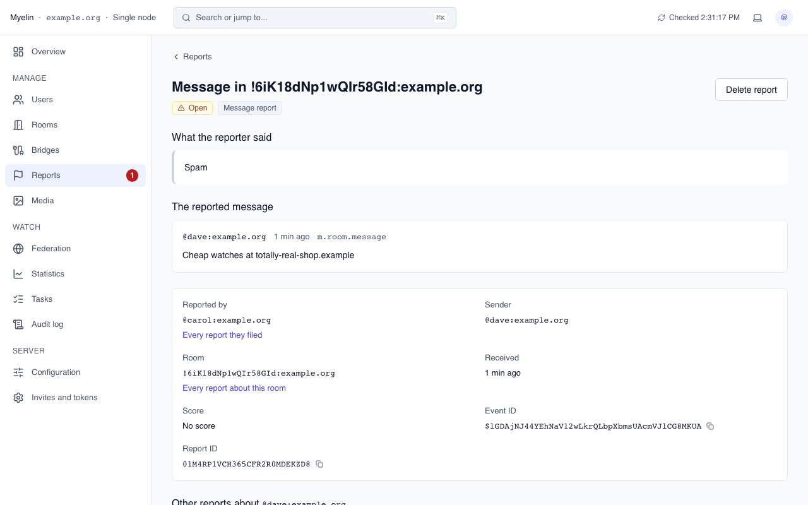

Under **Decide**, choose what was done, add a note for other moderators, and press **Resolve
report** (or **Dismiss report** for no action). Recording a decision does not act on its own: you
lock or deactivate a person on their page and block a room on its page, then record it here.

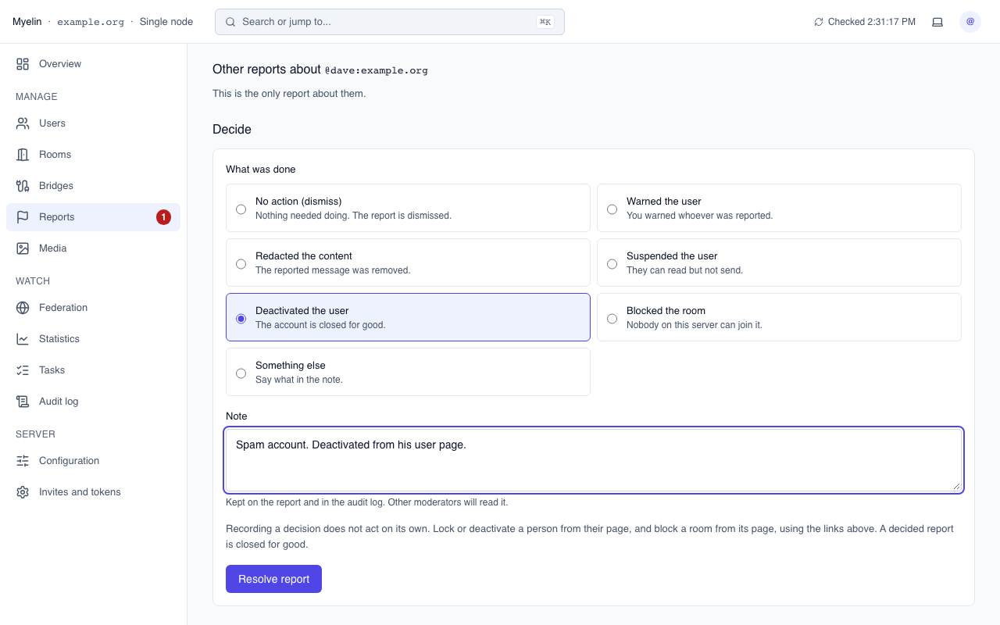

### Tasks

**Tasks** lists work that takes longer than a request: purges, room deletions, media deletions,
bridge replays and scans. Each has its status, what it acts on and who started it. Open one to
follow its progress. Finished tasks are kept for 30 days.

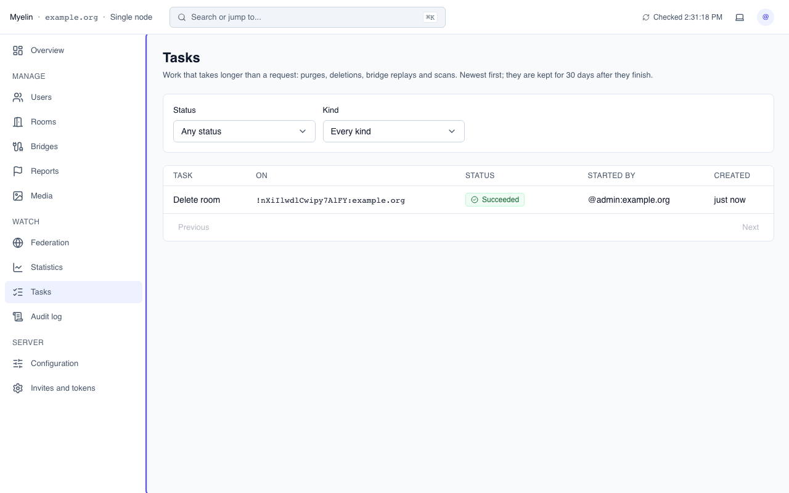

### Statistics

**Statistics** shows how the server is used: accounts, rooms, active users and stored media
now, and charts of activity over the range you choose. Daily and monthly active users are
sampled every 15 minutes, so a new server's charts start empty. **Show as table** gives each
chart's numbers. Further down are the largest rooms and whose uploads take the most space.

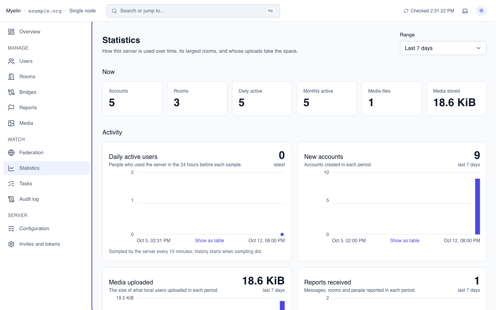

### Audit log

**Audit log** records who changed what, when, and whether it worked, newest first: accounts made
and deactivated, settings changed, rooms deleted, bridges offered, reports decided, and an
administrator reading a room's messages. Filter by who, action, resource, outcome and time;
open an entry for its full record. **Export NDJSON** downloads up to 10,000 entries of the
chosen date range.

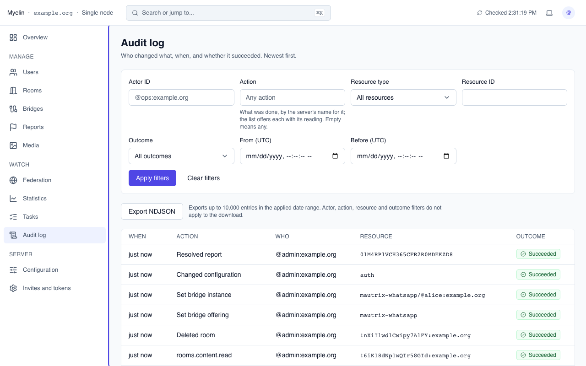

### API tokens

**Invites and tokens**, **API tokens** makes tokens for scripts, bots or other teams that need
part of the admin API. A token carries only the scopes you tick (for example
`moderation:read`); a request outside them is refused, and the refusal names the scope it needed.
The token is shown once when it is minted; the list afterwards shows what each can do, never the
token itself. Signing in to the interface with your own account still gives every scope.

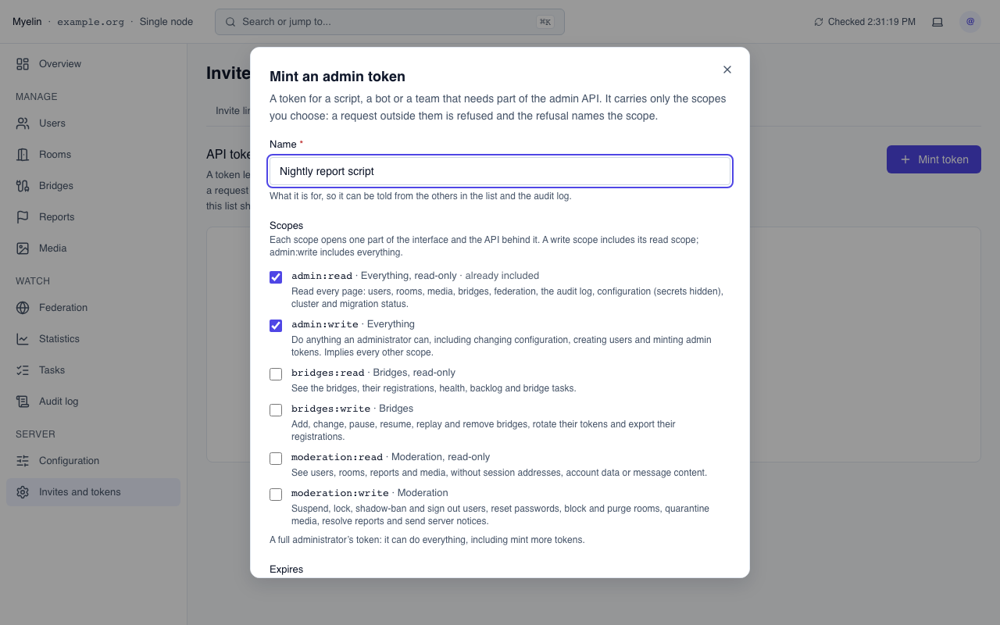

### Server notices

**Invites and tokens**, **Server notices** sends a message from the server itself: planned
downtime, a warning about an account, a change of rules. Add recipients (users on this server),
type the message and press **Send notice**. Each recipient gets it in their own server-notices
room. The notices sent are listed below. A single user's page has a **Send notice** button too.

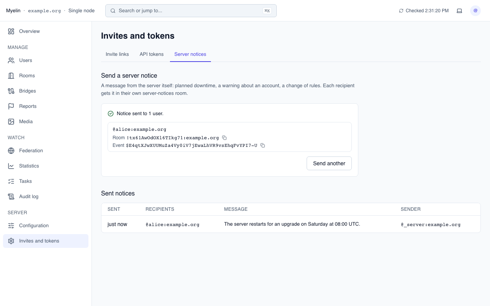

### Cluster

**Cluster** shows how the server runs: on a single node, one replica owns every shard and there
is nothing to drain. With more than one replica it lists each one with its status, shards,
zone, heartbeat and version, and **Drain** hands a replica's shards to the others before it is
taken down. The shard map below shows which replica owns what. The page is in the sidebar only
when there is more than one replica; on a single node, open `/admin/cluster`.

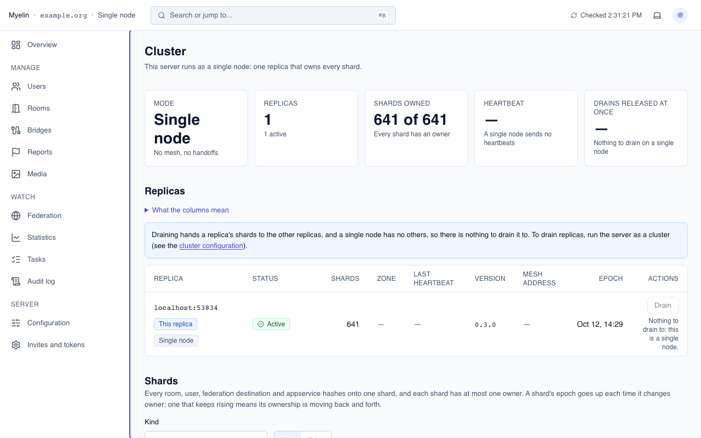

### Migration from Synapse

**Migration** copies a Synapse server's accounts, sessions, rooms, account data and media into
this one while Synapse keeps running, and then cuts over. Synapse's database is only ever read,
so until you cut over, rolling back is carrying on with Synapse. Step 1 points at Synapse's
PostgreSQL database and media store; the steps after it start the copy, verify it and complete
the cutover, and the page says what does not move before you start. The page is in the sidebar on a
new server and during a migration; otherwise open `/admin/migration`.

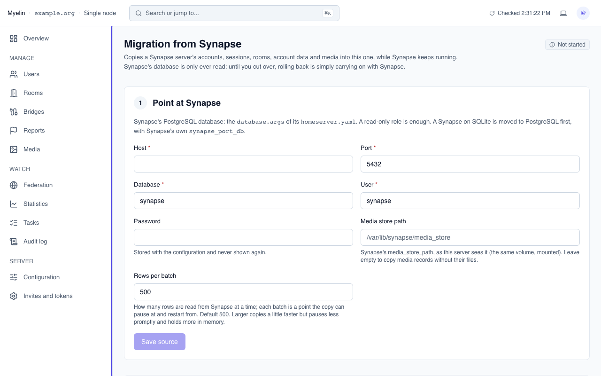

## 9. Where to go next

- `docs/install-and-upgrade.md`: installing, upgrading, rolling back and uninstalling on
  Kubernetes with Helm.
- `docs/recovery.md`: getting back in when nobody can sign in as an administrator.
- `docs/config.md`: every setting, its default and when a change applies.
- `docs/bridges/`: notes on individual bridges.

## How these screenshots were made

They come from `web/e2e-real/user-guide.spec.ts`, run against a real `hs serve` started on an
empty data directory. The spec makes the first administrator through the setup page, adds the
demo people and rooms through the admin and client-server APIs, and then does each task in this
guide through the interface. To take them again from the repository root:

```sh
cargo build -p hs-cli --bin hs
./target/debug/hs serve --data-dir /tmp/guide-data --server-name example.org   # note the setup link's token
cd web
HS_REAL_SERVER_URL=http://127.0.0.1:8008 \
HS_USER_GUIDE_SETUP_TOKEN=<the part after #token=> \
HS_USER_GUIDE_RECOVER_CMD="../target/debug/hs recover --data-dir /tmp/guide-data" \
HS_USER_GUIDE_SCREENSHOTS=1 \
  npx playwright test --config playwright.real.config.ts user-guide
```

Without `HS_USER_GUIDE_SCREENSHOTS=1` the images go to `web/test-results/user-guide/` and the
committed ones are left alone. The spec changes the server it runs against, so each run needs a
fresh data directory.
